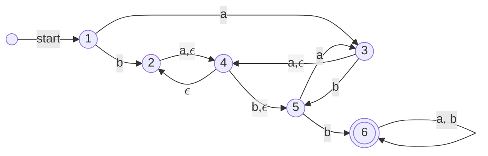
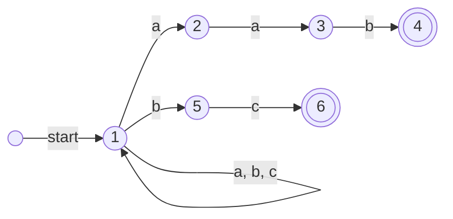
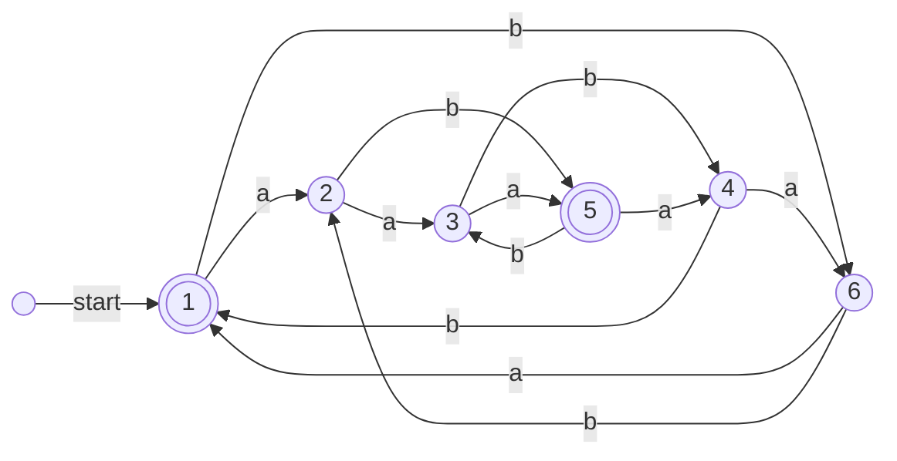
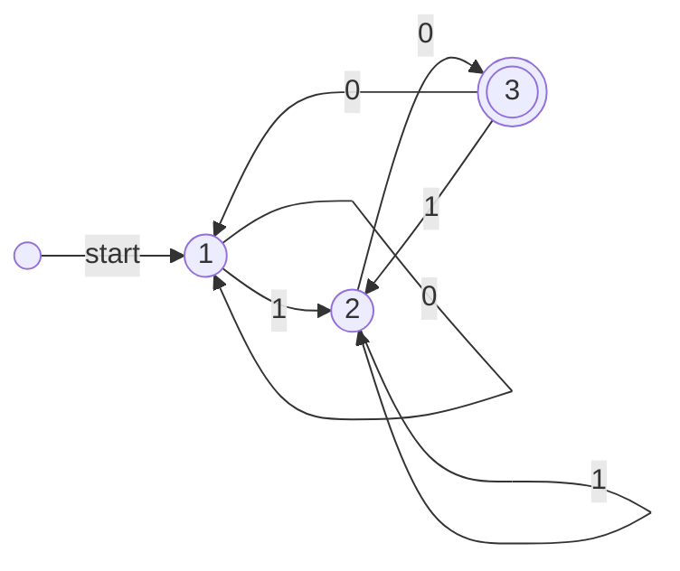
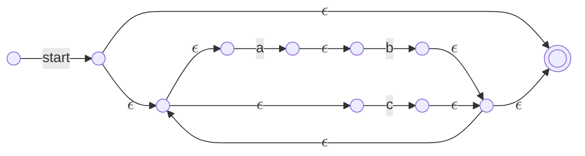

# 2026 fall 

## 1

$L = \{\epsilon, ba, aaa, abb, bab, abba, abbba\}, M = \{a, ab\}, N = \{a, ba\}$, 计算 $L - M^{*}N^{*}$

## 2

判断正误

1. $A(BA)^{*} = (AB)^{*}A$
2. $(A + B)^{*} = A^{*}(BA^{*})^{*}$
3. $(A^{*}B)^{*} = (A + B)^{*}B$

## 3

1. 求 ECLOSE(3)
2. 求等价 DFA，画出状态转移表

## 4

文本搜索的情景

构建等价 DFA

## 5

1. 求集合数最少的划分
2. 求状态数最少的等价 DFA

## 6

1. 状态消去法消去状态 2 后，列出发生变化的转移边，并写出等价的 RE
2. 求 $R^{(0)}{1, 1}, R^{(1)}{1, 2}, R^{(2)}{3, 3}$

## 7

求表示的 RE

## 8

$L = \{w \in \{a, b\}^{*} | w 中 b 的个数为偶数\}$

求 DFA

## 9

$L = \{w \in \{a, b\}^{*} | w 的倒数第 2 个字符为 b\}$

求 NFA

## 10

$L = \{w \in \{a, b\}^{*} | w 首尾字符相同，且包含子串 ab\}$

求 $\epsilon$ - NFA

## 11 

1. 合法的域名至少包含 2 个标签，且每个标签只能由 . 分隔，. 只能出现在相邻两个标签之间
2. 标签只能由英文字母，数字组成，不能为空
3. 最后一个标签必须只含英文 (顶级域名)

$L = \{w \in \{c, 1, .\}^{*} | w 是合法域名\}$

求 RE

## 12

$L = \{w \in \{a, b\}^{*} | w 是回文串，且不含 aa 子串\}$

求 CFG

## 13

$S \rightarrow aS | bS | Sa | Sb | a$ 

$L = \{uav | u, v \in \{a, b\}^{*}\}$

1. 证明 $\forall w \in L$, 有 $S \overset{*}\Rightarrow w$
2. 求无二义文法，无需证明

## 14

$S \rightarrow a | aSa | aTa$

$T \rightarrow b | bSb | bTb$

使用互归纳法证明，若 $S \overset{*}\Rightarrow w$, 则 $w$ 为首尾字符均为 a 的奇数长度回文串 (只能使用互归纳法)

